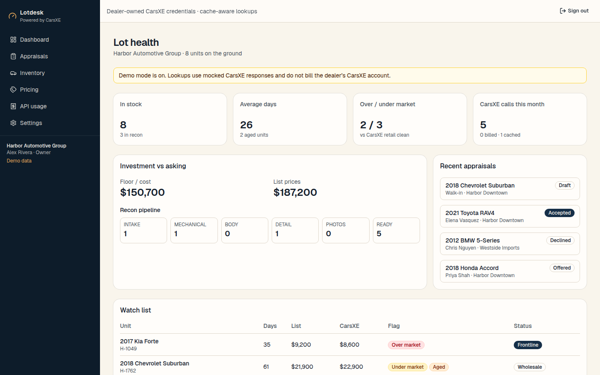
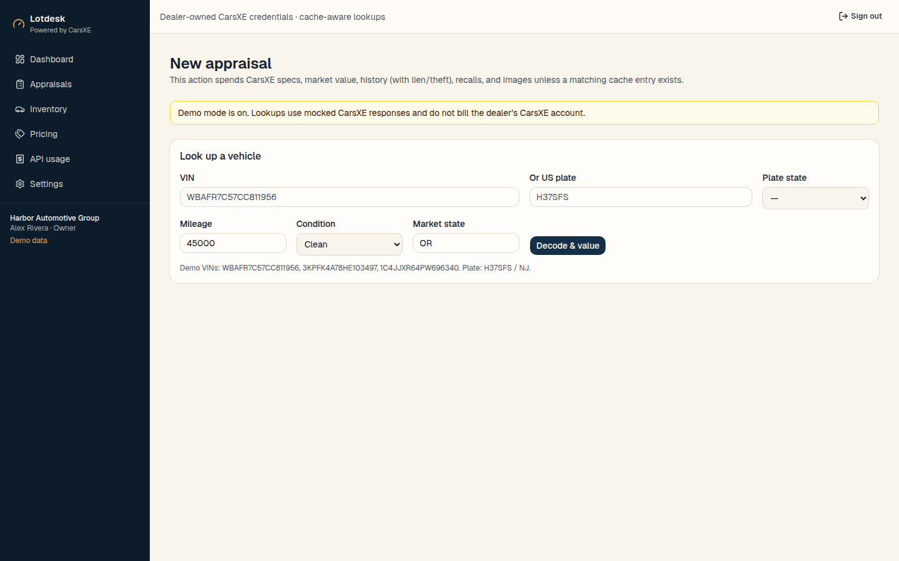
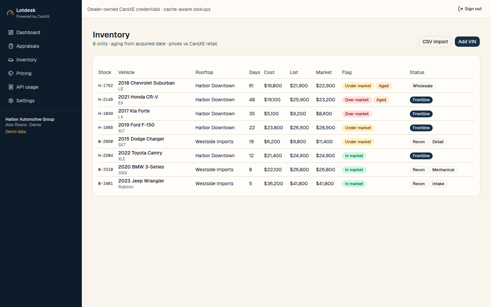
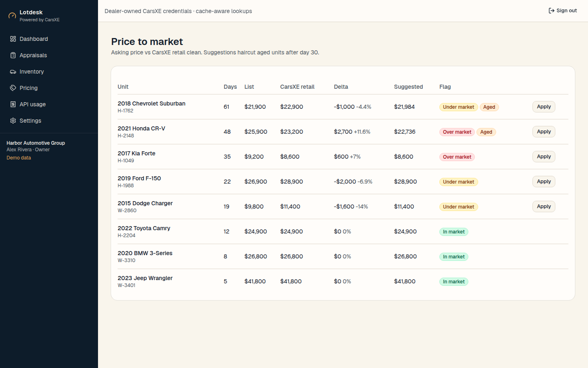
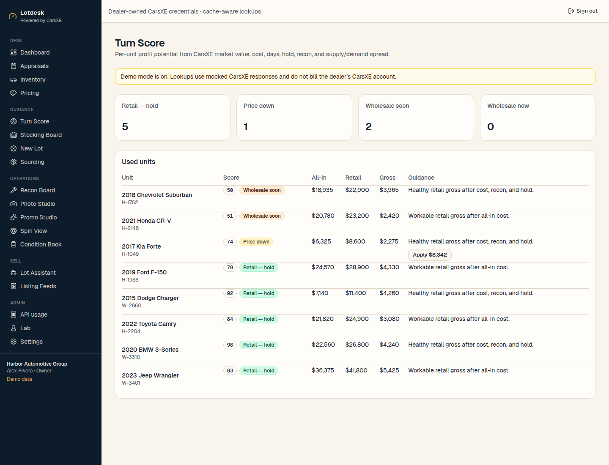
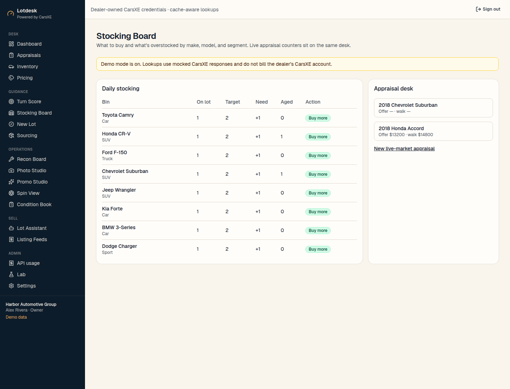
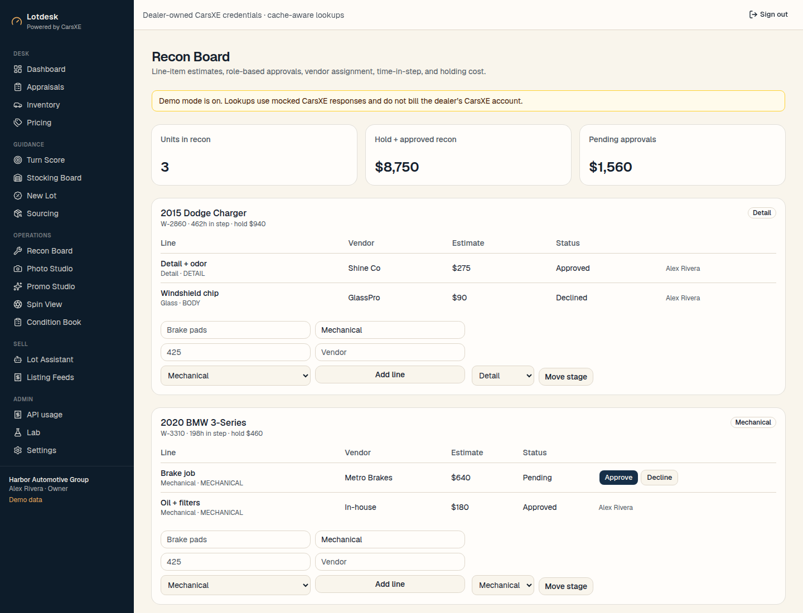
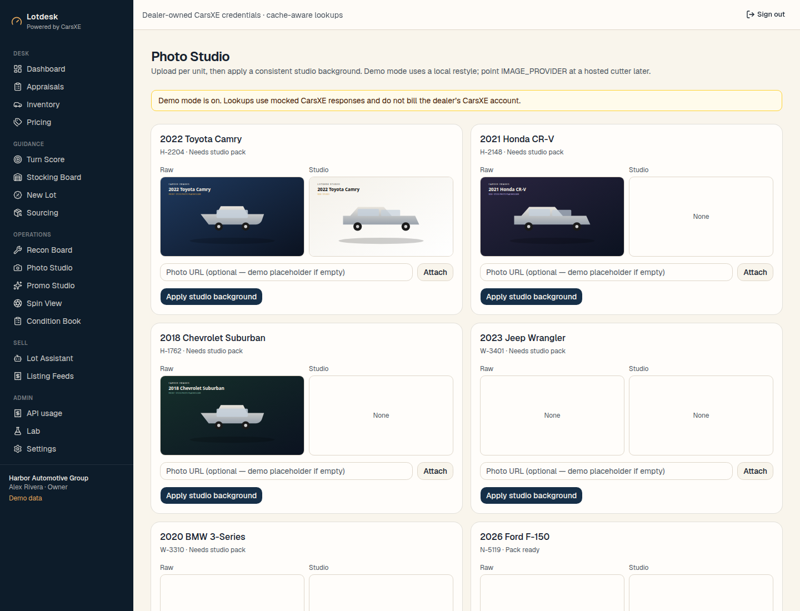
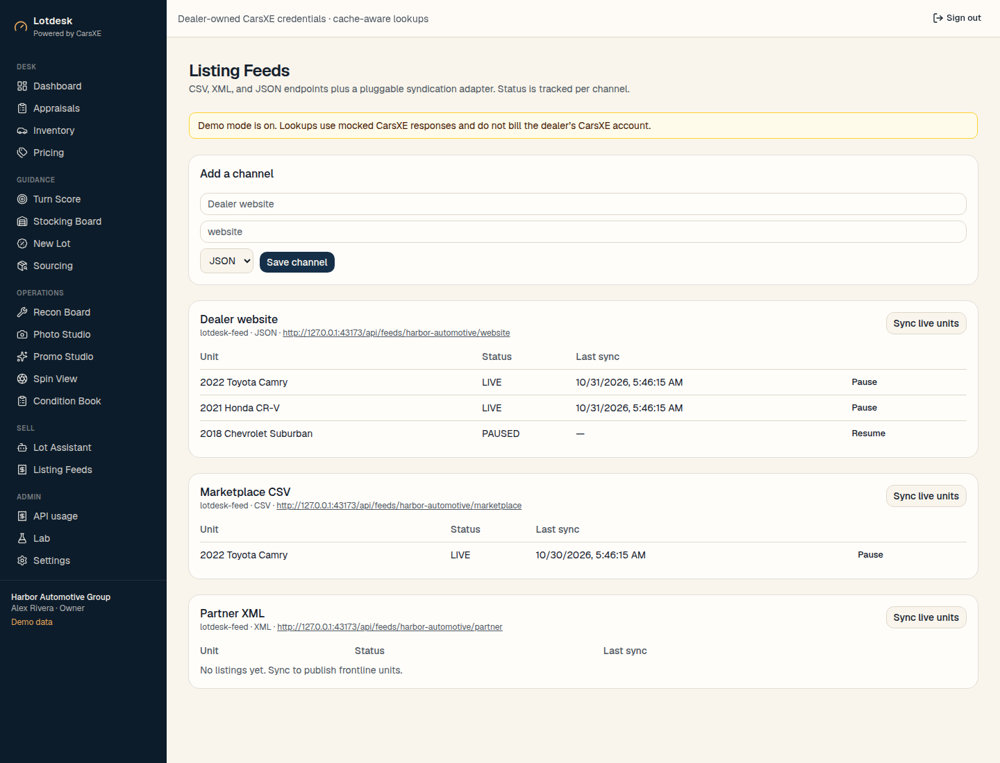
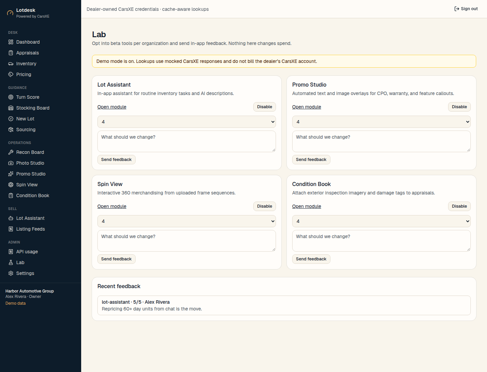

# Lotdesk

Free, open-source inventory, appraisal, pricing, recon, merchandising, and syndication for car dealers. **CarsXE, Inc.** gives the app away. Dealers pay CarsXE only for the vehicle data their own account consumes.

Lotdesk is a modern dealer desk: VIN/plate appraisal, Turn Score profit guidance, stocking, new-lot incentives, sourcing, recon approvals, photo/promo/spin merchandising, condition books, listing feeds, and a Lot Assistant — all backed by the [public CarsXE API](https://docs.carsxe.com).



## Feature matrix

| Lotdesk module | What it does | CarsXE data | Pluggable / BYO |
| --- | --- | --- | --- |
| **Appraisal desk** | VIN or US plate decode, live market, history, offer, stock accepted units | [Specs](https://docs.carsxe.com/api-reference/specifications/vehicle-specifications-vin-decoder), [market value](https://docs.carsxe.com/api-reference), [history](https://docs.carsxe.com/api-reference/history/vehicle-history), [recalls](https://docs.carsxe.com), [lien/theft](https://docs.carsxe.com), [plate decoder](https://docs.carsxe.com), [images](https://docs.carsxe.com) | — |
| **Inventory** | Add by VIN or CSV. Days, cost, list, rooftop, status, recon stage | Specs + market value on add/refresh | — |
| **Pricing** | Retail clean vs asking, aging, one-click suggested price | Market value | — |
| **Turn Score** | Per-unit profit potential and a clear recommendation (retail hold / price down / wholesale / do not buy) | Market value (retail, wholesale, trade-in). Demand/supply from the retail–wholesale spread | Scoring is local |
| **Stocking Board** | Daily buy / at-target / overstock by make, model, segment. Live appraisal counters | Market value on the appraisal desk | Target units per model is dealer-set |
| **New Lot** | New-unit MSRP/invoice dashboard plus incentive programs | Specs MSRP/invoice when a VIN is decoded. **No CarsXE incentives or window-sticker endpoint** — spec sheet stays the sticker fallback | `INCENTIVE_ADAPTER=manual\|http` |
| **Sourcing** | Aggregate auction/marketplace candidates, score vs Turn Score and stocking need | Fixture/live market when the VIN is known | `SOURCE_ADAPTER=csv` (+ adapter SDK) |
| **Recon Board** | Line items, approve/decline by role, vendor, time-in-step, holding cost | — | — |
| **Photo Studio** | Per-unit photos, studio background / cutout | [Images](https://docs.carsxe.com) for stock photography; studio restyle is local or BYO | `IMAGE_PROVIDER=demo\|http` |
| **Promo Studio** | CPO / warranty / feature overlays | Specs features for callouts | `IMAGE_PROVIDER` |
| **Spin View** | 360 player from a frame sequence, embeddable | — | Sequence upload / demo generator |
| **Condition Book** | Exterior inspection imagery + damage tags on appraisals | — | `INSPECTION_PROVIDER=demo\|http` (manual tagging works with no key) |
| **Lot Assistant** | AI descriptions from specs/features, cross-shop, commands like “reprice my 60+ day units” | Specs + market value | `AI_PROVIDER=demo\|http\|openai` |
| **Listing Feeds** | JSON / CSV / XML endpoints, per-channel status | Listing body can include CarsXE-backed description and photos | `SYNDICATION_ADAPTER=lotdesk-feed` |
| **Lab** | Per-org feature flags and in-app beta feedback | — | — |
| **Usage ledger** | Every billable CarsXE call, cache hits, demo lookups | All endpoints above | — |

There is **no window-sticker API** on [docs.carsxe.com](https://docs.carsxe.com). Merchandising uses the spec-sheet fallback (attributes, equipment, warranties, MSRP).

## What else shipped in v1

- Multi-user / multi-rooftop (owner, manager, appraiser)
- Demo mode with mocked CarsXE responses
- AES-256-GCM credential encryption
- OAuth 2.0 + PKCE stub (URLs from env only)

The app is free. Connecting a CarsXE key (or OAuth, when configured) uses **the dealer’s credentials**.

## Screenshots

| Desk | Inventory | Pricing |
| --- | --- | --- |
|  |  |  |

| Turn Score | Stocking | Recon |
| --- | --- | --- |
|  |  |  |

| Photo Studio | Listing Feeds | Lab |
| --- | --- | --- |
|  |  |  |

## Stack

Next.js (App Router) · TypeScript · Tailwind · shadcn/ui · Postgres · Prisma · Auth.js · AES-256-GCM credential encryption.

## Quickstart (Docker Compose)

```bash
git clone <this-repo> lotdesk
cd lotdesk
docker compose up --build
```

Open [http://127.0.0.1:43173](http://127.0.0.1:43173).

Demo login: `demo@lotdesk.dev` / `lotdesk-demo`

Also: `manager@lotdesk.dev` and `appraiser@lotdesk.dev` with the same password.

## Quickstart (local)

```bash
cp .env.example .env
# point DATABASE_URL at a local Postgres 16 database
npm install
npx prisma migrate deploy
npx prisma db seed
npm run dev
```

Dev server: [http://127.0.0.1:43173](http://127.0.0.1:43173)

## Get a CarsXE API key

1. Create an account at [carsxe.com](https://carsxe.com).
2. Copy the key from the CarsXE dashboard.
3. In Lotdesk: **Settings → paste API key**. Optionally uncheck demo mode to spend live lookups.

Read the API: [docs.carsxe.com](https://docs.carsxe.com) · [Get started](https://docs.carsxe.com/docs/get-started)

## CarsXE connection

| Method | Status |
| --- | --- |
| API key | Fully supported. Encrypted at rest. |
| OAuth 2.0 Authorization Code + PKCE | Implemented. Authorize/token URLs, client id, and scopes come from environment variables. No provider is hard-coded. |

```
CARSXE_OAUTH_AUTHORIZE_URL=
CARSXE_OAUTH_TOKEN_URL=
CARSXE_OAUTH_CLIENT_ID=
CARSXE_OAUTH_CLIENT_SECRET=
CARSXE_OAUTH_SCOPES=vehicle:read
CARSXE_OAUTH_REDIRECT_URI=http://127.0.0.1:43173/api/oauth/callback
```

## Pluggable providers

All AI / image / inspection / incentive / source / syndication providers default to **demo or manual** so the app runs with no keys. Point them at a hosted CarsXE (or self-hosted) provider later:

```
AI_PROVIDER=demo          # demo | http | openai
IMAGE_PROVIDER=demo       # demo | http
INSPECTION_PROVIDER=demo  # demo | http
INCENTIVE_ADAPTER=manual  # manual | http
SOURCE_ADAPTER=csv
SYNDICATION_ADAPTER=lotdesk-feed
```

`http` providers POST JSON to `*_URL` with optional `Authorization: Bearer *_KEY`.

## Caching and billing

Responses are cached per organization, endpoint, and normalized params.

| Family | Default TTL |
| --- | --- |
| Specs, plates, images, international VIN | 7 days |
| Market value | 12 hours (capped by org setting) |
| History, recalls, lien/theft | org cache TTL (default 24h) |

The usage page and the desk ribbon show billed vs. cache vs. demo.

## Hosted vs self-hosted

- **Managed:** deploy this repo as a multi-tenant service. Each dealership signs up, connects CarsXE, and works their lot.
- **Self-hosted:** `docker compose up`. Bring your own Postgres credentials and `ENCRYPTION_KEY` / `AUTH_SECRET`.

### One-Click Cloud Deployment

These buttons only work once the repository is public.

[](https://railway.com/new/template?template=https%3A%2F%2Fgithub.com%2Fcarsxe%2Flotdesk)
[](https://render.com/deploy?repo=https%3A%2F%2Fgithub.com%2Fcarsxe%2Flotdesk)

## Architecture

```
Dealer browser
    → Next.js (App Router, server actions)
        → Auth.js (dealership users)
        → Prisma / Postgres (orgs, rooftops, inventory, appraisals, recon, merch, feeds)
        → CarsXE gateway (cache → demo fixtures or live https://api.carsxe.com)
        → Pluggable AI / image / inspection / incentive / source / syndication adapters
```

Credentials never leave the server. The typed client lives in `src/lib/carsxe/`.

## License

MIT © CarsXE, Inc. See [LICENSE](LICENSE) and [CONTRIBUTING](CONTRIBUTING.md).
